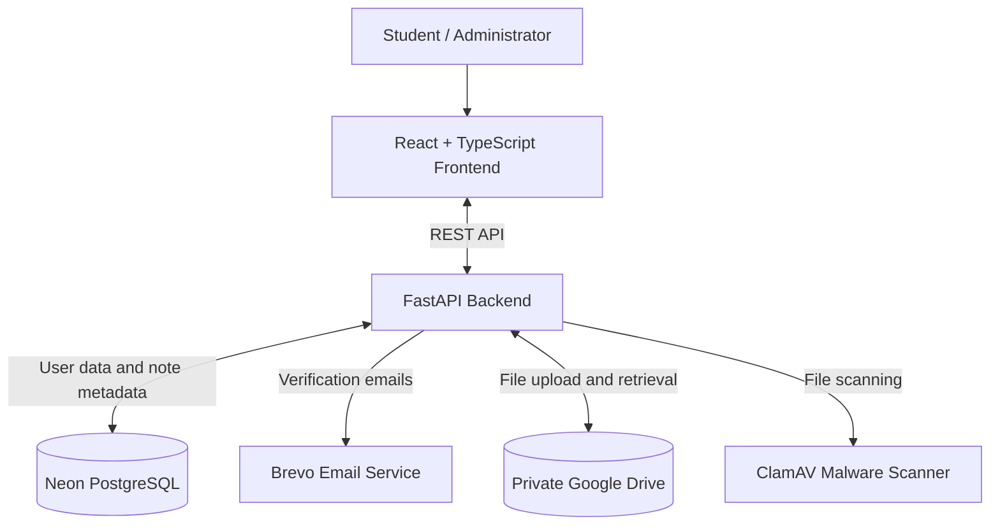
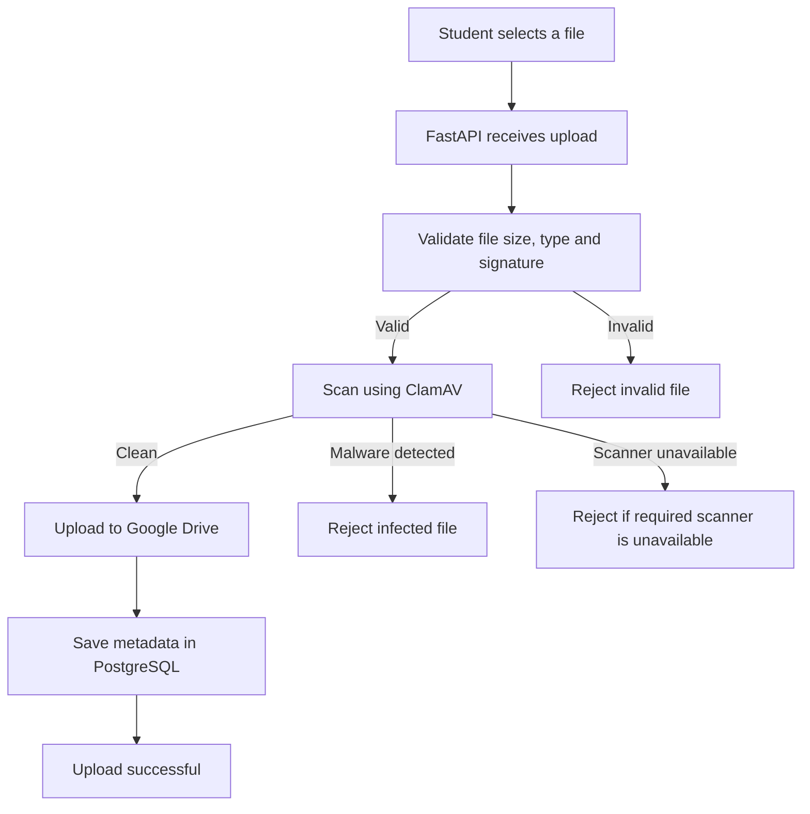

# 📚 NoteNest

### Share Knowledge. Learn Together.

NoteNest is a college-exclusive academic notes-sharing platform that enables verified students to upload, discover, organize, save, and download academic study materials.

Built to encourage collaborative learning, NoteNest provides a trusted environment where students can share knowledge and access useful academic resources within their college community.

**Institution:** SR University  
**Approved Email Domain:** `@sru.edu.in`

---

## ✨ Features

### Student Features
- College email-based registration and verification.
- Secure JWT authentication.
- Upload academic notes and study materials.
- Discover and search academic resources.
- Download notes securely.
- Save notes to a personal library.
- Manage uploaded notes.
- Report inappropriate content.
- Manage personal account information.

### Admin Features
- Role-based access control.
- Super Admin privileges.
- College email domain management.
- Report review and content moderation.

### Security Features
- Argon2 password hashing.
- JWT authentication.
- College email domain validation.
- File type and signature validation.
- Maximum upload size of 25 MB.
- ClamAV malware scanning.
- Private Google Drive storage.
- Authenticated file downloads.
- Reliable file deletion and storage handling.

---

## 🛠️ Technology Stack

| Category | Technology |
|:---|:---|
| Frontend | React, TypeScript, Vite |
| Backend | Python, FastAPI |
| Database | PostgreSQL, Neon |
| ORM | SQLAlchemy |
| Migrations | Alembic |
| Authentication | JWT |
| Password Security | Argon2 |
| Email Service | Brevo |
| File Storage | Google Drive API |
| Malware Scanning | ClamAV |
| Version Control | Git, GitHub |

---

## 🏗️ System Architecture

NoteNest follows a client-server architecture with external services for email delivery, file storage, and malware scanning.



### Application Workflow

1. Students register using an approved college email address.
2. The backend validates registration details.
3. Brevo sends an email verification link.
4. Verified students can log in and access the platform.
5. Uploaded files undergo validation and malware scanning.
6. Clean files are stored in private Google Drive storage.
7. File metadata and user information are stored in Neon PostgreSQL.
8. Authenticated students can discover, save, and download notes.

### File Upload Workflow



---

## 📁 Project Structure

```text
NoteNest/
│
├── backend/
│   ├── alembic/
│   │   └── versions/
│   │
│   ├── app/
│   │   ├── api/
│   │   │   └── v1/
│   │   │       ├── admin.py
│   │   │       ├── auth.py
│   │   │       ├── health.py
│   │   │       ├── library.py
│   │   │       └── notes.py
│   │   │
│   │   ├── core/
│   │   ├── db/
│   │   ├── models/
│   │   ├── schemas/
│   │   └── services/
│   │
│   ├── scripts/
│   ├── tests/
│   ├── requirements.txt
│   └── alembic.ini
│
├── frontend/
│   ├── src/
│   │   ├── App.tsx
│   │   ├── main.tsx
│   │   └── styles.css
│   │
│   ├── package.json
│   ├── package-lock.json
│   └── vite.config.ts
│
├── storage/
│   └── uploads/
│
├── docker-compose.clamav.yml
├── .env.example
├── .gitignore
└── README.md
```

---

## ⚙️ Getting Started

### Prerequisites

Make sure the following are installed:

- Python 3.11
- Node.js and npm
- Git
- Neon PostgreSQL account
- Brevo account
- Google Cloud account with Drive API enabled
- ClamAV

Check your installations:

```bash
python3 --version
node --version
npm --version
git --version
```

### 1. Clone the Repository

```bash
git clone https://github.com/Anvithsai06/NoteNest.git

cd NoteNest
```

### 2. Backend Setup

Navigate to the backend:

```bash
cd backend
```

Create a virtual environment:

```bash
python3.11 -m venv .venv
```

Activate it on macOS/Linux:

```bash
source .venv/bin/activate
```

On Windows:

```powershell
.venv\Scripts\activate
```

Install dependencies:

```bash
pip install -r requirements.txt
```

### 3. Environment Configuration

Create your backend environment file from the example.

Run this command from the `backend` directory only if `.env` does not already exist:

```bash
cp .env.example .env
```

Configure the following variables in `backend/.env`:

```env
APP_ENV=development

DATABASE_URL=postgresql+psycopg://<USERNAME>:<PASSWORD>@<HOST>/<DATABASE>?sslmode=require

JWT_SECRET_KEY=<YOUR_SECRET_KEY>

FRONTEND_ORIGIN=http://localhost:5173
PUBLIC_APP_URL=http://localhost:5173

EMAIL_PROVIDER=brevo
BREVO_API_KEY=<YOUR_BREVO_API_KEY>
EMAIL_FROM=NoteNest <your-verified-sender@example.com>

STORAGE_BACKEND=google_drive

GOOGLE_DRIVE_CLIENT_ID=<YOUR_CLIENT_ID>
GOOGLE_DRIVE_CLIENT_SECRET=<YOUR_CLIENT_SECRET>
GOOGLE_DRIVE_REFRESH_TOKEN=<YOUR_REFRESH_TOKEN>
GOOGLE_DRIVE_FOLDER_ID=<YOUR_FOLDER_ID>

MALWARE_SCANNING_ENABLED=true
MALWARE_SCANNING_REQUIRED=true
CLAMAV_HOST=127.0.0.1
CLAMAV_PORT=3310
```

Replace the placeholders with your actual credentials.

**Never commit `.env` files, API keys, database passwords, OAuth credentials, or refresh tokens to GitHub.**

---

## 🗄️ Database Configuration

NoteNest uses PostgreSQL hosted on Neon.

1. Create a Neon PostgreSQL project.
2. Obtain the database connection string.
3. Configure it as `DATABASE_URL` in `backend/.env`.
4. Ensure SSL is enabled.

Run database migrations from the backend directory:

```bash
alembic upgrade head
```

Check the current migration:

```bash
alembic current
```

View migration history:

```bash
alembic history
```

The database contains application records for users, notes, saved notes, reports, college domains, and email verification.

The initial approved college domain is `sru.edu.in`.

---

## 📧 Email Configuration

NoteNest uses the Brevo Transactional Email API for account verification.

Setup:

1. Create a Brevo account.
2. Verify your sender email address.
3. Generate a transactional email API key.
4. Configure the following in `backend/.env`:

```env
EMAIL_PROVIDER=brevo
BREVO_API_KEY=<YOUR_BREVO_API_KEY>
EMAIL_FROM=NoteNest <your-verified-sender@example.com>
```

For local development without external email delivery, console mode can be used:

```env
EMAIL_PROVIDER=console
```

In console mode, verification information is logged by the backend instead of being sent through Brevo.

---

## ☁️ Google Drive Configuration

NoteNest uses Google Drive for private academic file storage.

### Setup

1. Create a Google Cloud project.
2. Enable the Google Drive API.
3. Configure the OAuth consent screen.
4. Create an OAuth 2.0 Desktop application client.
5. Create a private Google Drive folder.
6. Obtain the OAuth credentials.

Configure the following variables:

```env
STORAGE_BACKEND=google_drive

GOOGLE_DRIVE_CLIENT_ID=<YOUR_CLIENT_ID>
GOOGLE_DRIVE_CLIENT_SECRET=<YOUR_CLIENT_SECRET>
GOOGLE_DRIVE_REFRESH_TOKEN=<YOUR_REFRESH_TOKEN>
GOOGLE_DRIVE_FOLDER_ID=<YOUR_FOLDER_ID>
```

### Generate the Refresh Token

From the backend directory:

```bash
.venv/bin/python scripts/authorize_google_drive.py
```

Complete the browser authorization using the dedicated NoteNest Google account.

Store the generated refresh token securely.

**Never make the Google Drive storage folder public or expose OAuth credentials to the frontend.**

---

## 🛡️ ClamAV Configuration

NoteNest uses ClamAV to scan uploaded files before storage.

### macOS Installation

Install ClamAV:

```bash
brew install clamav
```

Update virus definitions:

```bash
freshclam
```

Start the ClamAV daemon:

```bash
/opt/homebrew/opt/clamav/sbin/clamd
```

Keep the daemon running while using NoteNest.

### Docker Alternative

Start the ClamAV service:

```bash
docker compose -f docker-compose.clamav.yml up -d
```

Check its status:

```bash
docker compose -f docker-compose.clamav.yml ps
```

Stop the service:

```bash
docker compose -f docker-compose.clamav.yml down
```

Only one ClamAV instance should use the configured host and port.

Never expose the ClamAV TCP service publicly.

---

## 🚀 Running the Application

For local development on macOS, use three separate terminal windows.

### Terminal 1 — ClamAV

```bash
/opt/homebrew/opt/clamav/sbin/clamd
```

If using Docker, start the Docker Compose service instead.

### Terminal 2 — Backend

```bash
cd NoteNest/backend

source .venv/bin/activate

uvicorn app.main:app --host 127.0.0.1 --port 8000 --reload
```

### Terminal 3 — Frontend

```bash
cd NoteNest/frontend

npm install

npm run dev
```

### Application URLs

| Service | URL |
|:---|:---|
| Frontend | http://localhost:5173 |
| Backend | http://127.0.0.1:8000 |
| API Documentation | http://127.0.0.1:8000/docs |
| ReDoc | http://127.0.0.1:8000/redoc |

Keep the required services running while testing the application.

---

## 👑 Super Admin Setup

To promote an existing verified user to Super Admin, run the following command from the backend directory:

```bash
.venv/bin/python scripts/make_admin.py <VERIFIED_EMAIL>
```

The script verifies that the user exists and has a verified email before assigning the `super_admin` role.

---

## 🧪 Testing

### Backend Tests

From the backend directory:

```bash
source .venv/bin/activate

pytest
```

### Frontend Production Build

From the frontend directory:

```bash
npm run build
```

---

## 🔐 Security

NoteNest follows several security practices:

- Argon2 password hashing.
- JWT-based authentication.
- Approved college email domains.
- File signature and size validation.
- Malware scanning before file storage.
- Private Google Drive storage.
- Authenticated file retrieval.
- Environment-based credential management.
- Role-based administrative access.

Never commit secrets or environment files to the repository.

---

## 🗺️ Future Enhancements

Potential improvements include:

- Advanced academic search and filtering.
- Subject-wise and semester-wise organization.
- Note ratings and reviews.
- Student contribution statistics.
- Enhanced content moderation.
- Activity notifications.
- Administrative analytics.
- Dedicated mobile application.

---

## 👨‍💻 Author

**Anvith Sai**

B.Tech – Computer Science and Engineering (AI & ML)  
SR University

GitHub: [@Anvithsai06](https://github.com/Anvithsai06)

---

<div align="center">

### 📚 NoteNest

**Share Knowledge. Learn Together.**

Made for students, powered by collaboration.

</div>